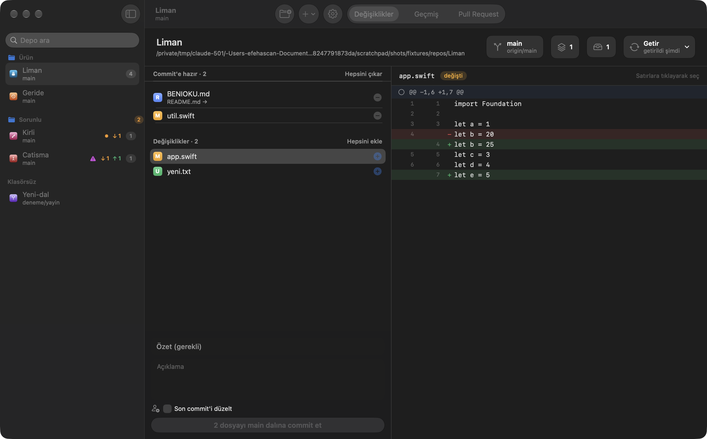
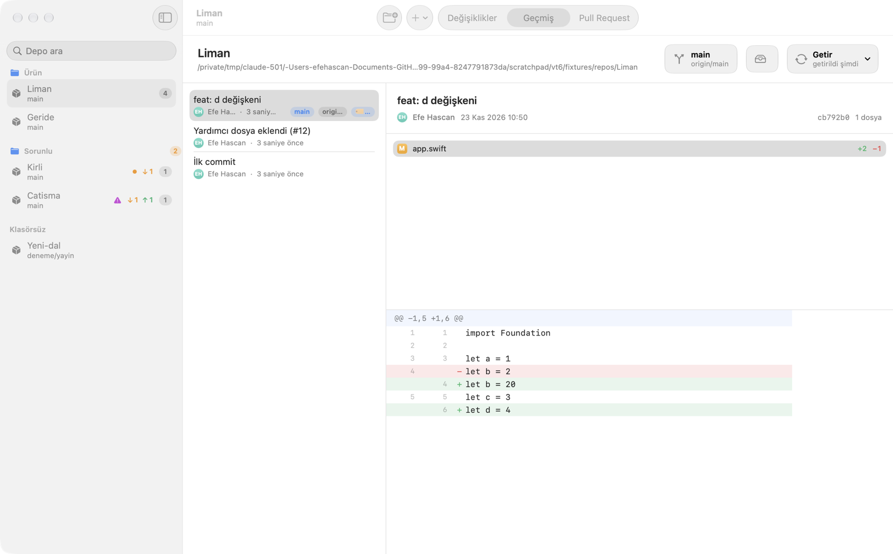
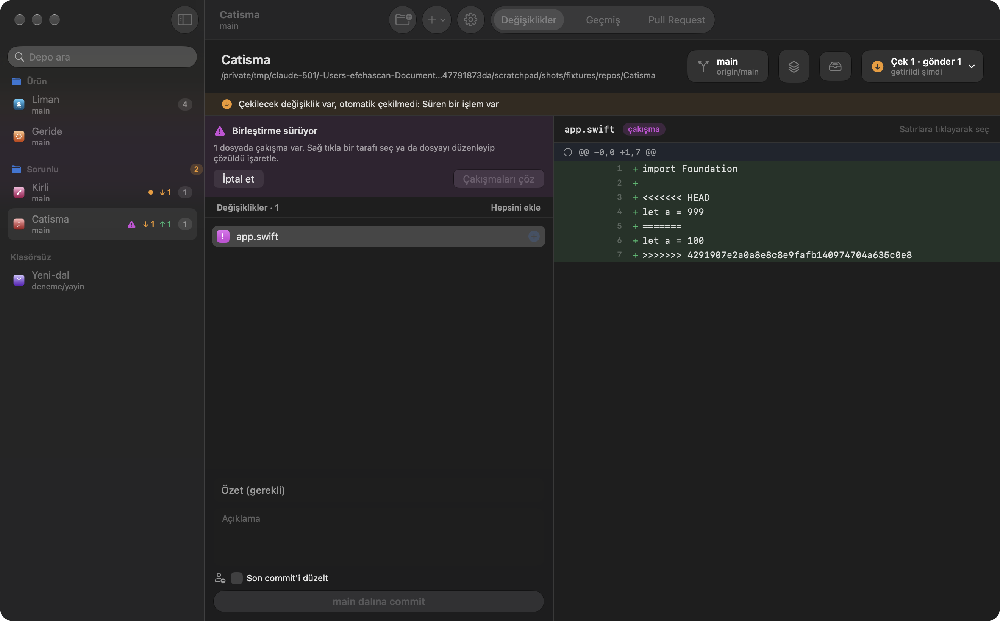

<p align="center"></p>

# Git Harbor Desktop

A fast, native git client for macOS. Everything you'd expect from a desktop git app, plus **auto-fetch and safe auto-pull**, and **named folders** to organize all your repositories in one sidebar.

<p align="center">
  
</p>

[Türkçe](README.tr.md)

## Features

- **Folders:** group repositories into named folders; drag and drop to move or reorder; drop folders from Finder to add them.
- **Auto-sync:** fetches every repository in the background (default every 5 min, at most 4 at a time). Pulls automatically **only when it's safe**: a clean working tree and no local commits, fast-forward only. Otherwise the repo shows why it wasn't pulled. Pauses in Low Power Mode. Optional notifications that carry the repository's logo.
- **Changes:** diff view, stage/unstage whole files or **selected lines**, discard (new files go to the Trash), commit with summary and description, amend, co-authors, stash (save, apply, pop, drop), ignore a file or extension.
- **Sync:** fetch, pull (merge or rebase), push, publish a branch; one button that shows what's next (Pull 3, Push 2…).
- **Conflicts:** banner during merge/rebase/cherry-pick; take ours/theirs, open in editor, mark resolved, abort or continue.
- **History and branches:** paged commit list, commit details and diff, create/switch/rename/delete branches, merge, rebase, cherry-pick, revert, tags, undo last commit, reset to a commit (keeps changes).
- **Repositories:** add existing, clone (from your GitHub account or a URL), create new (README, .gitignore, license), publish to GitHub.
- **Multi-clone:** pick several repositories from your GitHub account, or paste one URL per line; up to 3 clone at once and each is added as soon as it finishes. Failed ones stay selected for a retry.
- **Worktrees:** open another branch in its own folder (existing, new, or tracking `origin/x`), add it to the sidebar next to the main repo, remove it (never forced; uncommitted changes block removal and the branch is kept), prune stale entries.
- **Repository logos:** the sidebar shows each repo's own icon (app icon, `AppIcon.appiconset`, logo or favicon found in the repo), falling back to the GitHub owner's avatar.
- **GitHub:** sign in with the GitHub CLI session or a token (stored in the Keychain); pull requests with CI status, check details, open locally, create a PR; `#123` links.
- **Settings (⌘,):** theme (system, light, dark), editor, sync interval and auto-pull, notifications with a test button, GitHub account, git identity.
- **⌘K command palette,** menu bar status, open in your editor (VS Code, Cursor, Xcode, Zed, Sublime) or Terminal.
- Idle: ~0% CPU, ~50 MB memory. No polling: file changes are watched with FSEvents. No third-party dependencies; uses the system `git`.

<p align="center">
  
  
</p>

## Requirements

- macOS 26 (Tahoe) or later
- Xcode 26 / Swift 6.2 to build
- `git` (Xcode Command Line Tools); optionally the GitHub CLI (`gh`) for one-click sign-in

## Install

```sh
git clone https://github.com/efehascan/GitHarbor.git
cd GitHarbor
scripts/make-app.sh            # creates "dist/Git Harbor Desktop.app"
open "dist/Git Harbor Desktop.app"
```

The app is ad-hoc signed, not notarized. If you download a build instead of compiling it, right-click → Open the first time.

## Development

```sh
swift run GitHarbor                       # run in debug
scripts/check.sh                          # build + tests (compact output)
scripts/check.sh StatusParserTests        # one test group
scripts/make-fixtures.sh /tmp/fx          # 5 repositories with real remotes (behind, dirty, conflict, unpublished, rich)
scripts/visual-test.sh /tmp/shots         # real window captures of 17 scenarios, light and dark
```

- `Sources/HarborCore/`: models, git operations, parsers, sync policy, GitHub API (no UI, tested against real repositories).
- `Sources/GitHarbor/`: SwiftUI + AppKit interface.
- `docs/map/harbor.md`: architecture notes.

The interface text is currently in Turkish.

## How it was built

Built in one day by one developer with AI agents: Claude designed the skeleton, git layer and UI and reviewed the work; a local Qwen model wrote the single-file pieces with explicit rules (workspace edits, auto-sync policy, log/branch parsing, GitHub parsing, repo helpers), each gated by the build, tests and a second local model's review. End-to-end tests run against real repositories and a visual test captures real windows.

## License

[MIT](LICENSE)
