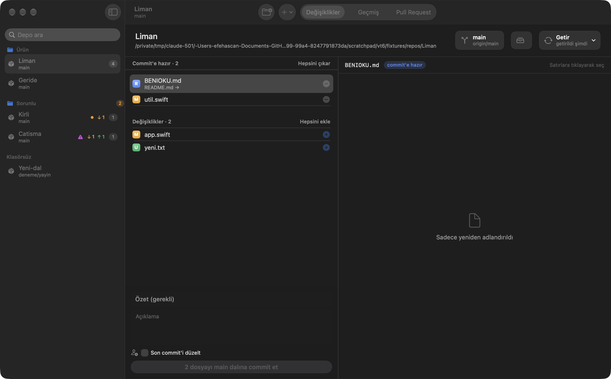
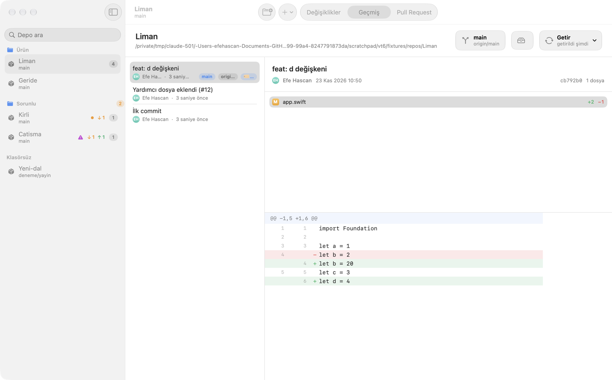
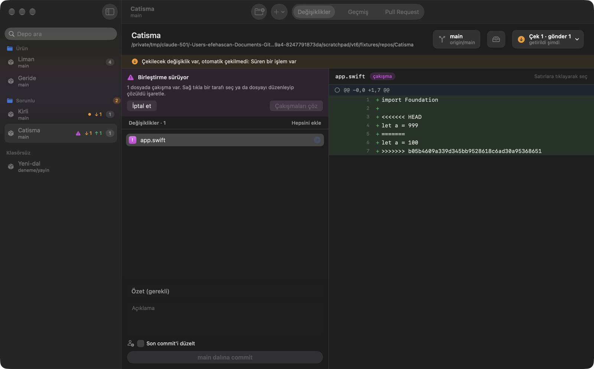

# Git Harbor Desktop

macOS için hızlı ve yerel bir git istemcisi. Masaüstü git uygulamasından beklediğin her şey, üstüne **otomatik fetch ve güvenli otomatik pull** ve bütün depolarını tek kenar çubuğunda düzenleyen **adlandırılmış klasörler**.

<p align="center">
  
</p>

[English](README.md)

## Özellikler

- **Klasörler:** depoları adlandırdığın klasörlerde topla; sürükle-bırakla taşı ya da sırala; Finder'dan klasör bırakarak ekle.
- **Otomatik senkron:** her depo arka planda fetch edilir (varsayılan 5 dk, aynı anda en çok 4). **Yalnızca güvenliyse** otomatik pull: temiz klasör ve gönderilmemiş commit yok, yalnızca ileri sarma. Değilse depo neden çekilmediğini gösterir. Düşük güç modunda durur. İsteğe bağlı bildirim.
- **Değişiklikler:** fark görünümü; dosyayı ya da **seçili satırları** commit'e ekle/çıkar; geri al (yeni dosyalar Çöp Sepeti'ne); özet ve açıklamayla commit, amend, ortak yazar; stash (sakla, uygula, geri getir, sil); dosyayı ya da uzantıyı yok say.
- **Senkron:** fetch, pull (merge ya da rebase), push, dal yayınlama; sıradaki işi gösteren tek düğme (Çek 3, Gönder 2…).
- **Çakışmalar:** merge/rebase/cherry-pick sırasında şerit; benimkini/onlarınkini kullan, editörde aç, çözüldü işaretle, iptal ya da bitir.
- **Geçmiş ve dallar:** sayfalı commit listesi, commit ayrıntısı ve farkı; dal oluştur/geç/yeniden adlandır/sil; merge, rebase, cherry-pick, revert, etiketler; son commit'i geri al; bir commit'e dön (değişiklikler kalır).
- **Depolar:** var olanı ekle, klonla (GitHub hesabından ya da adresten), yeni oluştur (README, .gitignore, lisans), GitHub'a yayınla.
- **GitHub:** GitHub CLI oturumuyla ya da token'la giriş (Anahtar Zinciri'nde); CI durumlu pull request'ler, kontrol ayrıntıları, yerelde aç, PR oluştur; `#123` bağlantıları.
- **⌘K komut paleti,** menü çubuğu durumu, editörde (VS Code, Cursor, Xcode, Zed, Sublime) ya da Terminal'de aç.
- Boştayken ~%0 CPU, ~50 MB bellek. Yoklama yok: dosya değişiklikleri FSEvents ile izlenir. Dış bağımlılık yok; sistemdeki `git` kullanılır.

<p align="center">
  
  
</p>

## Gereksinimler

- macOS 26 (Tahoe) ya da üstü
- Derlemek için Xcode 26 / Swift 6.2
- `git` (Xcode Command Line Tools); tek tıkla giriş için isteğe bağlı GitHub CLI (`gh`)

## Kurulum

```sh
git clone https://github.com/efehascan/GitHarbor.git
cd GitHarbor
scripts/make-app.sh            # "dist/Git Harbor Desktop.app" oluşturur
open "dist/Git Harbor Desktop.app"
```

Uygulama ad-hoc imzalıdır, notarize değildir. Derlemek yerine hazır sürüm indirirsen ilk açılışta sağ tık → Aç.

## Geliştirme

```sh
swift run GitHarbor                       # debug çalıştır
scripts/check.sh                          # derleme + testler (kısa çıktı)
scripts/check.sh StatusParserTests        # tek test grubu
scripts/make-fixtures.sh /tmp/fx          # gerçek uzaklı 5 depo (geride, kirli, çakışmada, yayınlanmamış, zengin)
scripts/visual-test.sh /tmp/shots         # 13 senaryonun gerçek pencere görüntüsü, açık ve koyu
```

- `Sources/HarborCore/`: modeller, git işlemleri, ayrıştırıcılar, senkron politikası, GitHub API (arayüzsüz, gerçek depolarla test edilir).
- `Sources/GitHarbor/`: SwiftUI + AppKit arayüz.
- `docs/map/harbor.md`: mimari notlar.

## Nasıl yapıldı

Tek geliştirici ve yapay zekâ ajanlarıyla bir günde yapıldı. İskeleti, git katmanını ve arayüzü Claude tasarladı ve işi inceledi. Kuralları açık yazılmış tek dosyalık parçaları local Qwen modeli yazdı: çalışma alanı düzenlemeleri, otomatik senkron kararı, log ve dal ayrıştırma, GitHub ayrıştırma, depo yardımcıları. Her parça derleme, testler ve ikinci bir local modelin incelemesinden geçti. Uçtan uca testler gerçek depolarla çalışır; görsel test gerçek pencere görüntüsü alır.

## Lisans

[MIT](LICENSE)
